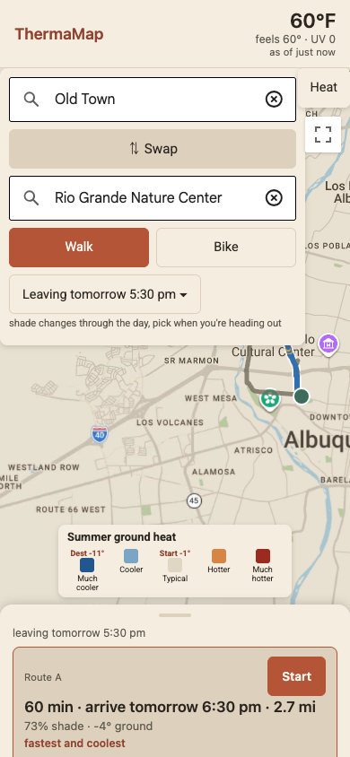
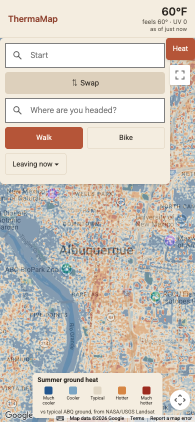
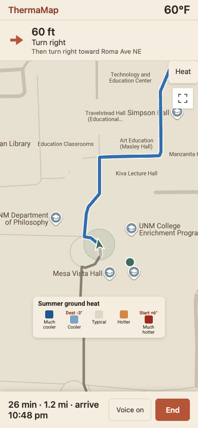
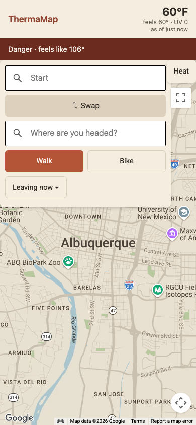

# ThermaMap

A walking and biking route planner for Albuquerque that actually cares about
heat. Google Maps will get you from A to B the fastest way. ThermaMap looks
at real satellite ground temperature and tree canopy data and tries to get
you there the coolest way instead, even if that means a couple extra
minutes.

It's built for the people summer in ABQ is hardest on: kids walking home
from school, older folks running errands on foot, people waiting on buses
in direct sun, and anyone working outside who needs to know which blocks
are going to be brutal before they're standing in them. A fast route and a
cool route are often not the same route, and most map apps never tell you
that.

Runs as a regular website in any browser, and also wraps as a real iPhone
app through Capacitor, with native location, haptics, and a screen that
stays on while you're navigating.

## Screenshots

Route cards after a search, with the picked route colored by shade and
ground heat:

The heat layer toggled on, showing ground temperature relative to typical
ABQ ground across the city:

Turn by turn navigation, mid-route:

The heat warning banner when it's dangerously hot out:

## How it works

ThermaMap scores every route Google hands back using three real datasets,
all specific to Albuquerque, and picks the one that keeps you coolest
without making the trip unreasonably longer.

**Ground temperature.** 121 Landsat 8/9 thermal scenes from May through
September, 2019 through 2026, cloud-masked using the QA band and combined
with a median instead of a mean, so one hazy or unusually cool day doesn't
drag a pixel around. Landsat's thermal band is natively about 100m
resolution even though the delivered file is 30m, so each scene gets
sharpened down using the real 30m optical bands first. It's a TsHARP-style
regression (Kustas 2003) against NDVI and surface albedo, since
Albuquerque has so much bare ground and pavement that greenness alone
doesn't explain the heat pattern the way it might somewhere greener. 120
of the 121 scenes sharpened cleanly with an R² above 0.3; the average R²
across every attempt was 0.69. The one scene that didn't clear the bar
just falls back to the unsharpened pixel instead of guessing.

Every pixel gets compared against a citywide baseline, but the baseline is
computed from developed areas only (anywhere near a building or tall
tree), not the whole bounding box. The wide fetch area pulls in a lot of
open desert and mesa that runs hot and was dragging the "typical ABQ"
baseline up, which made the actual city look artificially cool by
comparison. That baseline currently sits at 118.8°F ground temperature,
from about 1.18 million developed 30m cells. The citywide 5th to 95th
percentile range is 92.1°F to 128.3°F. That really is how hot pavement
gets in direct July sun, since this is ground temperature, not air
temperature.

**Tree canopy.** Meta and World Resources Institute's global canopy height
map, clipped to the Albuquerque area and reprocessed into 5m and 30m
percent-cover grids. Anything under 3m tall doesn't count as a tree for
shade purposes, since shrubs and low stuff don't shade someone walking.
Citywide canopy cover comes out to 7.7%, which sounds low but this is a
desert city. Canopy percent correlates with ground temperature anomaly at
-0.71 across the whole grid, so more trees reliably means cooler ground
here.

**Shadows.** A combined obstacle grid (building height from lidar, tree
height from the canopy data, whichever is taller at each 5m cell) gets ray
traced against the sun's real position for July 15, hour by hour from 7am
to 7pm, using the standard NOAA solar position formulas. Solar noon
elevation on that date comes out to about 76.3°, about what you'd expect
for Albuquerque's latitude in July. Anything the ray hits counts as
shaded. Rooftops get flagged separately from shade, since a tall pixel
with low canopy percent is probably a building and not a tree, so the app
can tell you "no street level data" there instead of a confident but
meaningless shade number. Downtown comes out noticeably shadier than the
open west side at every hour checked: 52% vs 13% at 9am, 46% vs 11% at
5pm.

**The score.** Each route gets sampled every 10 meters. At every sample,
the app blends toward whichever hour's shade map is relevant for that
point in the trip, so a route that starts shaded and ends in open sun
around 2pm reflects that instead of using one flat number for the whole
trip. Sun-exposed time gets weighted extra if the ground there also reads
hotter than typical: `heatFactor = 1 + max(0, anomaly) / 30`, applied only
to sunny stretches, so a hot patch you're walking through in shade doesn't
get penalized twice. The route with the lowest total score wins, as long
as it covers enough of the trip with real data (at least half) and isn't
unreasonably longer than the fastest option. That's capped at 1.5x the
fastest time or the fastest time plus 20 minutes, whichever is smaller, so
a short trip can still take a meaningfully shadier detour but a four hour
walk doesn't end up two hours longer chasing a few percent more shade.

If none of Google's own alternatives are much cooler, the app samples
points off to the side of the fastest route looking for a shadier street
Google didn't suggest, and will splice in a short detour if it clears a
real bar for improvement without overlapping too much with the route it's
replacing.

**Navigation.** Turn by turn directions with a heat hint, something like
"shady for the next quarter mile" or "sunny stretch ahead, about 3
minutes," looking ahead from wherever you currently are on the route. If
you drift off the route for a few GPS fixes in a row it reroutes
automatically, with a cooldown so it's not re-requesting routes over
ordinary GPS noise.

**Weather and alerts.** Current conditions from Google's Weather API, with
a straight fallback to the National Weather Service's station feed if
that call fails. NWS active alerts for the area get checked and ranked
(Extreme Heat Warning over Extreme Heat Watch over Heat Advisory), and
separately, if the feels-like temperature crosses 103°F or 90°F without
an official alert active, the app shows its own heat risk banner anyway,
since NWS doesn't always have something posted even when it's genuinely
dangerous out.

**The iPhone app.** Same web app wrapped with Capacitor. Native
geolocation instead of the browser API, a native keep-awake plugin so the
screen doesn't lock mid-walk, haptic taps on turn announcements and
arrival, and it catches up right away when you bring the app back to the
foreground instead of waiting for the next GPS tick.

## What didn't work, or needed a second pass

A few things that didn't work on the first try, or turned out different
than expected once there was real data to look at:

- The citywide heat baseline originally included the whole fetch bounding
  box, desert and mesa included. That dragged the baseline hot and made
  developed Albuquerque look cooler than it should by comparison. Switched
  to a developed-areas-only baseline instead.
- A handful of small nodata gaps in the combined Landsat median (mostly
  cloud edges) get filled from their neighbors in a few short passes
  instead of left blank, so small holes close up but genuinely large gaps
  still mostly stay empty rather than getting guessed at.
- Canopy density near a route used to count a single tree 150 meters away
  as enough to call a desert pixel "developed." That needed an actual
  local density check, not just one tall pixel nearby.
- The "within 1.5x the fastest route" rule for picking a slower-but-cooler
  route was too loose once tested against longer trips: a four hour walk
  could end up two hours longer chasing marginal shade. Capped it at
  whichever is smaller, 1.5x or plus 20 minutes.
- A couple of the spot checks didn't come out quite how the code comments
  expected going in. The Sunport sample point actually reads 1.5°F below
  the citywide baseline instead of clearly hot like the comment expected,
  and Los Ranchos reads 0% canopy at its exact sample point despite being
  a leafy area overall, probably because it just landed on a road or open
  field between the orchards there. Coronado Center and the Rio Grande
  bosque both came out exactly as expected (+19°F and 100% canopy), so
  the pipeline is doing the right thing broadly. Individual point samples
  just aren't guaranteed to land somewhere representative.
- The exported web data (heat tiles plus the scoring grid) ended up around
  90MB, over the original rough 60MB target. Decided that was fine rather
  than cutting a zoom level or dropping shade hours.

## Limitations, honestly

The shade model is baked for one date, July 15, at one set of sun angles.
It'll be noticeably off in winter when the sun sits much lower, and it
doesn't account for leaf-off deciduous trees either. There's a TODO in the
code about this that hasn't been addressed yet.

The Landsat overpass is mid-morning, not the hottest part of the
afternoon, so the ground temperature snapshot is a decent proxy for
relative heat between streets but isn't a literal "temperature at 3pm"
reading. And it's ground temperature, not air temperature. Real pavement
genuinely gets hotter than the air above it, which is part of the point,
but it means the numbers in the app read hotter than what a weather app
would tell you.

The lidar building and tree height data is mostly from a 2010 survey,
with a sliver of newer 2016 and 2019 coverage filling in some edges of
the metro. Anything built, planted, or torn down since then won't be
reflected in the shadow model.

The heat exposure weighting itself, how much extra a hot sunny stretch
counts against you, is a first pass. It hasn't been tuned against a real
season of actually walking routes and comparing predicted heat to felt
heat, just picked by eye and adjusted a little. There's a `?tune=1` dev
harness in the app for checking picks against a fixed set of real
Albuquerque trips, and a `?fieldtest=1` mode for logging what a spot
actually felt like against what the app predicted there, but neither has
enough real runs behind it yet to say the weighting is well calibrated.

The routing, search, and weather all depend on Google. There's a NWS
fallback for current conditions specifically, but if Places or Routes has
an outage or a quota problem, there's no second routing provider behind
it.

Navigation only tracks your position while the app is in the foreground.
True background tracking would need the background location permission,
which this intentionally doesn't ask for. A location-always prompt for a
walking directions app felt like more than this needed to ask of someone.

And if you build and run the iPhone app with a free Apple ID instead of a
paid developer account, the install expires after about a week and needs
re-running from Xcode. That's an Apple account limit, not anything
specific to this app.

## Running it yourself

**Google Cloud.** You'll need a project with the Maps JavaScript API,
Places API, Routes API, and Weather API all enabled, and a browser API
key restricted by HTTP referrer to your dev and deploy domains
(`localhost` and wherever you host it). Browser map keys are visible by
design, so the restriction is what protects them, not hiding the key. If
you're also building the iPhone app you need a second key restricted by
iOS bundle identifier instead, since a WKWebView request doesn't carry a
website referrer the way a browser tab does. An iOS-restricted key won't
authenticate for web requests and a website-restricted key won't
authenticate for the app, hence the two separate keys. The Weather API
specifically caps out around 300 calls a day on typical free tier limits,
which is why the refresh loop only checks it every 5 minutes.

Both keys go in `js/config.js`: `GOOGLE_MAPS_KEY_WEB` and
`GOOGLE_MAPS_KEY_IOS`. The app picks whichever one actually applies at
runtime and falls back to the web key if the iOS slot is empty.

**Running the web app.** `python3 serve.py` serves the app at
`localhost:8000` with caching turned off, so edits show up on refresh
without fighting the browser cache. A plain `python3 -m http.server`
works too, just with caching on.

**Running the iPhone app.** `npm install`, then `npm run ios` (copies the
web files into `www/` and runs `npx cap sync ios`), then `npx cap open
ios` to open it in Xcode. Pick the App target, set your team under
Signing & Capabilities, choose a simulator or a real device from the
scheme selector at the top, and run. After any web code change, `npm run
ios` again re-syncs it into the native project.

**The data pipeline**, in `data-scripts/`, run in this order:

1. `fetch_landsat.py`, downloads the raw summer Landsat scenes
2. `sharpen_lst.py`, sharpens each scene's thermal band using its optical bands
3. `process_lst.py`, combines all scenes into one ground temperature map and anomaly grid
4. `fetch_canopy.py`, downloads the raw canopy height tiles
5. `process_canopy.py`, builds the 5m and 30m canopy percent grids (needs step 3's output for grid alignment)
6. `fetch_heights.py`, downloads lidar and combines it with canopy height into one obstacle grid (needs step 5's output)
7. `make_shade.py`, ray traces hourly shadows from the obstacle grid
8. `export_web.py`, exports the heat tiles and scoring grid the web app actually loads

Steps 5 and 6 have to run in that order even though it looks backwards.
The obstacle grid needs the canopy height data as an input, not the other
way around.

**Dev URL params**, all off by default:

- `?tune=1` runs a fixed set of real Albuquerque trips through the real
  scoring code and logs a table of what got picked
- `?fieldtest=1` adds a "log a reading" button for recording what a spot
  actually felt like against the app's prediction
- `?simnav=1` simulates movement along the route so navigation can be
  tested from a laptop without real GPS
- `?simoff=1`, combined with `simnav`, drifts off the route partway
  through so rerouting is easy to trigger and watch
- `?fakealert=1` shows the heat alert banner without a real NWS alert
- `?fakeheat=106` overrides the feels-like temperature for testing the
  heat risk banner at any value
- `?debugscore=1` logs a score table for the current routes
- `?debugdetours=1` logs the shady-detour candidate search and draws
  debug markers on the map
- `?fastrefresh=1` logs every refresh tick to the console

## Data sources and credits

- [**Landsat 8/9 Collection 2 Level 2**](https://www.usgs.gov/landsat-missions/landsat-collection-2-level-2-science-products)
  surface temperature and surface reflectance, USGS/NASA, fetched via
  [Microsoft's Planetary Computer](https://planetarycomputer.microsoft.com/dataset/landsat-c2-l2).
  US government work, public domain.
- [**3DEP lidar**](https://www.usgs.gov/3d-elevation-program) height-above-ground,
  USGS, also via [Planetary Computer](https://planetarycomputer.microsoft.com/dataset/3dep-lidar-hag).
  Public domain.
- [**High Resolution Canopy Height Maps**](https://registry.opendata.aws/dataforgood-fb-forests/),
  Meta (Data for Good) and World Resources Institute, 2024. Licensed
  [CC BY 4.0](https://creativecommons.org/licenses/by/4.0/). Credit to
  Meta and WRI, with a note that changes were made, since this app
  resamples and re-derives percent cover from it.
- [**National Weather Service API**](https://www.weather.gov/documentation/services-web-api)
  for current observations, active alerts, and the fallback weather path.
  NOAA, public domain.
- [**Google Maps Platform**](https://developers.google.com/maps) (Maps,
  Places, Routes, and Weather APIs) for the map itself, place search,
  walking and biking directions, and primary current conditions. Subject
  to [Google's own terms of service](https://cloud.google.com/maps-platform/terms).
- Solar position formulas are the standard
  [NOAA solar calculator](https://gml.noaa.gov/grad/solcalc/) equations.

## What's next

The biggest open item is real field validation: walking and biking actual
routes across a hot summer, logging what it actually felt like with
`?fieldtest=1`, and using that to check whether the heat weighting in
`score.js` is actually right or just a reasonable-looking guess. After
that, a second shade bake for winter sun angles would close the biggest
dated gap in the model.
